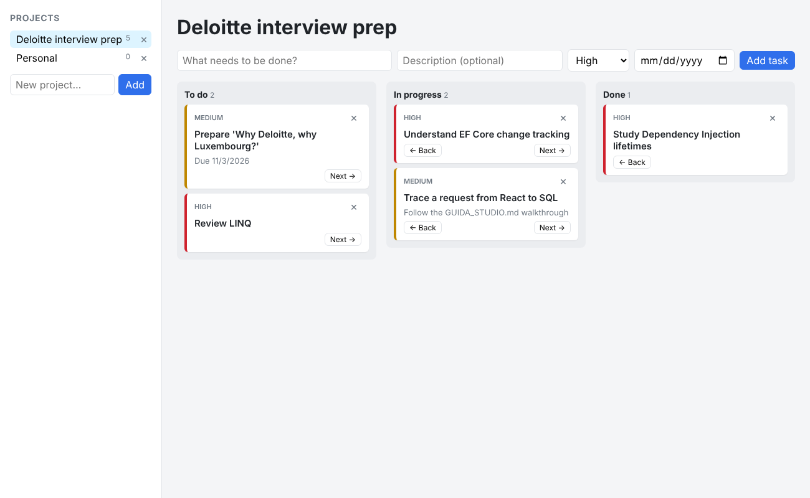

# Task Manager

A full-stack Kanban-style task manager built with **ASP.NET Core**, **Entity Framework Core**, **PostgreSQL** and **React + TypeScript**, fully containerized with **Docker Compose**.

Tasks are organized into projects and move across three columns — *To do*, *In progress* and *Done*.



## Features

- Create and delete projects, with a live task count per project
- Create tasks with a title, description, priority and due date
- Move tasks across the board, with **optimistic UI updates** and automatic rollback if the request fails
- Server-side validation with consistent error responses ([RFC 9457 Problem Details](https://www.rfc-editor.org/rfc/rfc9457))
- Interactive API documentation (OpenAPI + Scalar)
- One-command startup with Docker Compose

## Tech stack

| Layer | Technologies |
|-------|--------------|
| Frontend | React 19, TypeScript, Vite, served by nginx |
| Backend | ASP.NET Core 10 Web API, C# |
| Data access | Entity Framework Core 10, Npgsql |
| Database | PostgreSQL 17 |
| Infrastructure | Docker, Docker Compose (multi-stage builds) |

## Architecture

```
┌──────────────┐  HTTP / JSON  ┌────────────────────────────────────────────┐        ┌────────────┐
│ React SPA    │ ────────────▶ │ ASP.NET Core Web API                       │  SQL   │ PostgreSQL │
│ (nginx:5173) │ ◀──────────── │ Controllers → Services → DbContext (EF)    │ ─────▶ │   (:5432)  │
└──────────────┘               └────────────────────────────────────────────┘        └────────────┘
                                                (:5080)
```

The backend follows a layered design with dependencies pointing in one direction:

- **Controllers** handle HTTP only: routing, model binding and status codes. They contain no business logic and never access the database directly.
- **Services** contain the business logic and the EF Core queries. They are exposed through interfaces (`ITaskService`, `IProjectService`) and injected via the built-in dependency injection container, which keeps controllers decoupled and testable.
- **DbContext** (EF Core) maps entities to tables, tracks changes and saves them as a single unit of work.
- **DTOs** define the API contract. Entities are never returned directly: separate input and output DTOs prevent over-posting, avoid serialization cycles and keep the database schema independent from the API.
- A **global exception handler** turns domain exceptions into Problem Details responses (e.g. `NotFoundException` → `404`), so controllers stay free of `try/catch` blocks.

On the frontend, each folder has a single responsibility: `types/` mirrors the backend DTOs, `api/` wraps `fetch` with centralized error handling, `hooks/` encapsulates state and data fetching (including request cancellation with `AbortController`), and `components/` contains presentational UI.

## Getting started

### Run everything with Docker

Requires [Docker Desktop](https://www.docker.com/products/docker-desktop/).

```bash
docker compose up -d --build
```

| Service | URL |
|---------|-----|
| Web app | http://localhost:5173 |
| API docs (Scalar) | http://localhost:5080/scalar |
| PostgreSQL | `localhost:5432` (database, user and password: `taskmanager`) |

The database schema is created on first startup and seeded with sample data.

```bash
docker compose logs -f api   # backend logs, including the SQL generated by EF Core
docker compose down          # stop the containers (data is kept in a volume)
docker compose down -v       # stop and delete the database
```

### Local development

Run only the database in Docker, and the backend and frontend locally (hot reload and debugging):

```bash
docker compose up -d db

# Backend — requires the .NET 10 SDK
cd backend/TaskManager.Api
dotnet run

# Frontend — requires Node.js 20+
cd frontend
npm install
npm run dev
```

Locally, the API reads its connection string from `appsettings.json` (`Host=localhost`). Inside Docker, Compose overrides it with the `ConnectionStrings__Default` environment variable (`Host=db`), so the same image runs in both environments without code changes.

> The credentials in `docker-compose.yml` and `appsettings.json` are for local development only.

## API

| Method | Endpoint | Description | Success |
|--------|----------|-------------|---------|
| `GET` | `/api/projects` | List projects with their task count | `200` |
| `POST` | `/api/projects` | Create a project | `201` |
| `DELETE` | `/api/projects/{id}` | Delete a project and its tasks | `204` |
| `GET` | `/api/tasks?projectId=&status=` | List tasks, optionally filtered | `200` |
| `GET` | `/api/tasks/{id}` | Get a task | `200` |
| `POST` | `/api/tasks` | Create a task | `201` |
| `PUT` | `/api/tasks/{id}` | Replace a task's editable fields | `200` |
| `PATCH` | `/api/tasks/{id}/status` | Move a task to another column | `200` |
| `DELETE` | `/api/tasks/{id}` | Delete a task | `204` |

Errors are returned as Problem Details: `400` for validation errors and `404` for missing resources. Ready-to-run requests, including error cases, are in [`TaskManager.Api.http`](backend/TaskManager.Api/TaskManager.Api.http).

## Implementation notes

- **No N+1 queries.** Read queries project directly into DTOs with `Select`, so EF Core generates a single SQL statement with only the needed `JOIN`s and columns. Project task counts are computed in the database with a `COUNT` subquery, not in memory.
- **Read vs. write queries.** Read-only queries use `AsNoTracking()`; updates load tracked entities, so EF Core's change tracker generates `UPDATE` statements for the modified columns only.
- **Async all the way**, with a `CancellationToken` propagated from the request down to the database, so abandoned requests stop their queries.
- **Schema configuration** with the Fluent API: string length limits, a one-to-many relationship with cascade delete, an index on `Tasks.ProjectId`, and enum storage chosen per column (status as text for readability, priority as an integer so it sorts correctly).
- **UTC dates.** PostgreSQL `timestamp with time zone` columns require UTC values, so incoming dates are normalized in the service layer.
- **Race-free data fetching.** The React hooks cancel in-flight requests when the selected project changes, so a slow response can never overwrite newer data.

## Project structure

```
├── docker-compose.yml
├── backend/TaskManager.Api/
│   ├── Program.cs           # DI registration and HTTP pipeline
│   ├── Controllers/         # HTTP layer
│   ├── Services/            # Business logic and queries
│   ├── Data/                # DbContext and seed data
│   ├── Models/              # Entities
│   ├── DTOs/                # API contract and validation
│   ├── Middleware/          # Global exception handling
│   └── Dockerfile
└── frontend/
    ├── src/
    │   ├── types/           # TypeScript mirrors of the backend DTOs
    │   ├── api/             # HTTP client
    │   ├── hooks/           # State and data fetching
    │   └── components/      # UI components
    └── Dockerfile
```

## Roadmap

- [ ] Replace `EnsureCreated` with EF Core migrations
- [ ] Unit tests (xUnit) and integration tests with Testcontainers
- [ ] Authentication with JWT
- [ ] Pagination and search
- [ ] CI pipeline with GitHub Actions
